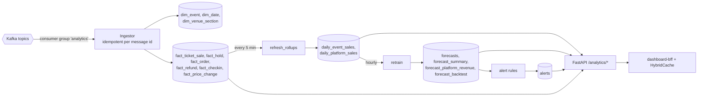

# Analytics and forecasting

The analytics service is the read side of the system. It never queries another service's database;
everything it knows arrives over Kafka, gets written into a small star schema, rolled up, and used
to fit forecasts that the dashboard reads back as plain rows.

## Data flow

Scheduling uses APScheduler inside the process ([`app/main.py`](../src/services/analytics/app/main.py)).
In Kubernetes, a CronJob can run `python -m app.jobs all` instead ([`cronjob-forecast.yaml`](../deploy/helm/ticket-hub/templates/cronjob-forecast.yaml)).

## Schema

| Table | Grain | Filled from |
|---|---|---|
| `dim_event` | one row per event | `events.event-published/updated/cancelled` |
| `dim_venue_section` | one row per section per event | `events.event-published` |
| `dim_date` | one row per day (`date_key` = yyyymmdd) | generated by rollups |
| `fact_ticket_sale` | one row per seat sold | `orders.order-paid` (price, section, tier, weekday, hour, lead days precomputed) |
| `fact_hold` | one row per hold, with outcome held/converted/expired/released | `seating.*` |
| `fact_order` | one row per order with status | `orders.order-created/paid/expired/refunded`, `tickets-issued` |
| `fact_refund` | one row per refunded order | `orders.order-refunded` |
| `fact_checkin` | one row per admitted ticket | `orders.ticket-checked-in` |
| `fact_price_change` | one row per tier price change | `pricing.price-updated` |
| `daily_event_sales` | event × day (with cumulative tickets) | rollup |
| `daily_platform_sales` | day | rollup |
| `forecasts` | event × future day, with 80% interval | retrain |
| `forecast_summary` | event | retrain |
| `forecast_platform_revenue` | future day | retrain |
| `forecast_backtest` | one row per retrain | retrain |
| `alerts` | active rule hits | after refresh and retrain |
| `processed_events` | message id × consumer | ingestion dedupe |

On SQL Server the six fact tables have **clustered columnstore indexes** (with nonclustered primary
keys), created in [`alembic/versions/0001_initial.py`](../src/services/analytics/alembic/versions/0001_initial.py).
Columnstore compresses the append-only facts well and makes the scan-and-aggregate queries cheap.
Tests run the same models on SQLite, where that DDL is skipped.

Weekday, hour and lead days are computed at ingest time rather than in SQL, which keeps the queries
portable and the heatmap a simple `GROUP BY weekday, hour`.

## Forecasting models

Code: [`app/forecasting.py`](../src/services/analytics/app/forecasting.py), orchestrated by
[`app/jobs.py`](../src/services/analytics/app/jobs.py).

### Per-event daily sales

1. Build the daily ticket series from the on-sale date up to yesterday (missing days are zeros).
2. **Seven or more days of history:** fit statsmodels `ExponentialSmoothing` on `log1p(tickets)`:
   additive damped trend, plus additive weekly seasonality once there are three weeks of data.
   The log transform keeps predictions positive and tames the on-sale spike.
   Forecast every day until the event; the 80% interval is `±1.2816 σ` of the in-sample residuals,
   transformed back with `expm1`.
3. Holt-Winters can't know about the rush in the last week before an event. If a reference curve
   from similar events is available and implies more remaining sales than Holt-Winters does, the
   forecast is scaled up halfway towards it.
4. **Fewer than seven days:** use the **similar events** curve. For completed events of the same
   category and size bucket (small < 500, medium < 2000, large), compute `frac[d]`, the share of final
   sales already made with `d` days to go, and average them. Current sales divided by `frac[now]`
   gives the projected final; the curve's increments give the daily forecast (±30% band). With no
   similar events, a generic front-loaded curve `1 - (d/W)^1.6` is used.
5. Cumulative forecasts are capped at capacity. The **predicted sell-out date** is the first day the
   cumulative forecast reaches capacity; the **projected final sell-through** is the last cumulative
   value over capacity.
6. **Pace status:** `Sold out` if sold ≥ capacity, `On track` if projected sell-through ≥ 80%,
   otherwise `At risk`.

### Platform revenue

Daily platform revenue (up to 365 days) is fitted with Holt-Winters (damped additive trend, additive
weekly seasonality) and forecast 90 days ahead; the dashboard sums the first 30/60/90 days. The band
is the residual σ widened slowly with the horizon (`1.2816 σ √(1 + h/14)`), an approximation rather
than the model's analytic interval. For organizers, the BFF passes their event ids and analytics fits
a scoped model on request.

### Backtest

For every completed event with at least 14 days of sales, fit on the first 60% of its selling window
(with a reference curve built from the *other* events), forecast the rest, and compare cumulative
tickets day by day. MAPE is averaged over events and stored in `forecast_backtest`; the dashboard
shows it next to the revenue forecast so the owner knows how much to trust the numbers.

| Data | Backtest MAPE |
|---|---|
| Synthetic test curves (`tests/synthetic.py`, 6 events) | ≈ 2–3 % (test asserts < 25 %) |
| `seed-history` (23 completed events) | ≈ 4–5 % |

Cumulative MAPE is a forgiving metric: by the 60% point most tickets are already sold. Daily-level
error is much higher, which is why the UI shows bands rather than single lines.

## Alerts

Evaluated after every refresh and retrain ([`app/alerts.py`](../src/services/analytics/app/alerts.py)):

| Rule | Condition | Example |
|---|---|---|
| `low-sell-through` | event within 60 days and projected sell-through < 60% | "Echo Valley In Concert is forecast to reach only 54% sell-through" |
| `sell-out-soon` | predicted sell-out within 3 days | "Mira Patel is predicted to sell out by 29 Nov" |
| `refund-spike` | ≥ 5 tickets and ≥ 10% of the event's tickets refunded in the last 7 days | "Refund spike for … 75 tickets refunded in the last 7 days (13%)" |
| `low-checkin` | event in the last 14 days, ≥ 20 tickets, check-in rate < 70% | "Check-in rate for … was 64%, under the 70% threshold" |

## Seed history

[`tools/seed-history`](../tools/seed-history) writes about a year of synthetic facts directly (the
read side is ours to rebuild), then runs the refresh and retrain jobs. It deliberately includes
events pacing badly, a refund spike and a low check-in show, so every alert type is visible.

## Limitations

- Forecasts know nothing about marketing pushes, artist announcements or competing events; a sudden
  spike will be read as trend for a few days.
- The interval is based on residual spread, not a proper predictive distribution, and is narrower
  than reality far from the fit window.
- Rollups are rebuilt in full every five minutes. Fine for this scale; a busier platform would want
  incremental rollups keyed on `date_key`.
- Similar-events matching is coarse (category + size bucket). City, day of week and price level all matter too.
- Analytics is eventually consistent: a few seconds behind Kafka and up to five minutes behind for rollups.
