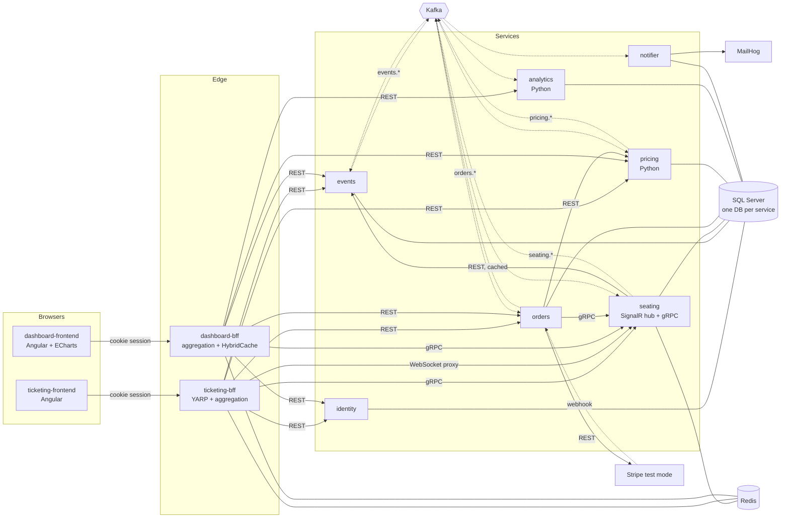

# Architecture

ticket-hub is split along the lines of who owns which data and how fast it has to be. The seat map
and holds have to be correct under contention and fast, so they live in Redis behind one service.
Money and tickets need transactions and an audit trail, so orders owns them in SQL Server. Pricing
and analytics are numeric work that is nicer in Python with pandas and statsmodels. The two frontends
want completely different things from the backend, so each has its own BFF.

## System overview

Solid arrows are synchronous calls (REST or gRPC). Dashed arrows are asynchronous Kafka messages.



## Services

| Service | Language | Local port | Store | Responsibility |
|---|---|---|---|---|
| `identity` | .NET 9 | 5201 | SQL Server `TicketHub_Identity` | users, roles, password hashing, JWT access tokens, rotating refresh tokens |
| `events` | .NET 9 | 5202 | SQL Server `TicketHub_Events` | venues, events, sections, seats, price tiers, draft → published → cancelled |
| `seating` | .NET 9 | 5203 (HTTP) / 5213 (gRPC) | Redis + SQL Server `TicketHub_Seating` | seat holds and locks, availability, sold seats, gRPC API, SignalR hub |
| `orders` | .NET 9 | 5204 | SQL Server `TicketHub_Orders` | orders, payments (Stripe test or mock), webhooks, refunds, tickets and QR, check-in, cancellation saga |
| `notifier` | .NET 9 | 5205 | SQL Server `TicketHub_Notifier` | email via MailKit using Razor component templates, sent-mail log |
| `pricing` | Python 3.13 / FastAPI | 8001 | SQL Server `TicketHub_Pricing` | demand-based tier prices, price locks per hold, price history |
| `analytics` | Python 3.13 / FastAPI | 8002 | SQL Server `TicketHub_Analytics` | star schema built from events, rollups, forecasts, backtest, alerts |
| `ticketing-bff` | .NET 9 + YARP | 5000 | Redis | session + tokens for the ticketing app, aggregation, proxying, WebSockets |
| `dashboard-bff` | .NET 9 | 5100 | Redis | session + tokens for the dashboard, scoping, caching, CSV export |
| `ticketing-frontend` | Angular 19 | 3000 | – | buyers, organizers, door staff |
| `dashboard-frontend` | Angular 19 | 3100 | – | owner and organizer analytics |

Shared .NET code lives in [`shared/TicketHub.BuildingBlocks`](../shared/TicketHub.BuildingBlocks)
(hosting defaults, Kafka, outbox/inbox, JWT validation), [`shared/TicketHub.BffKit`](../shared/TicketHub.BffKit)
(cookie session, token store, CSRF) and [`shared/TicketHub.Contracts`](../shared/TicketHub.Contracts)
(event payloads and topic names). The gRPC contract is [`shared/protos/seating.proto`](../shared/protos/seating.proto).

## Data ownership

Every service has its own database and its own SQL login; there are no cross-database queries and no
shared tables. Locally one SQL Server container hosts all of them (see [`deploy/helm/ticket-hub/files/init.sql`](../deploy/helm/ticket-hub/files/init.sql));
in Azure they are separate databases on one logical server, with analytics on a larger SKU.

| Data | Owner | Everyone else gets it via |
|---|---|---|
| Users and roles | identity | JWT claims (`sub`, `role`, `email`, `name`) |
| Events, seat maps, base tiers | events | REST (`/events/{id}/layout`), `events.event-*` messages |
| Live seat state and holds | seating (Redis) | gRPC `SeatingRpc`, SignalR, `seating.*` messages |
| Sold seats | seating (SQL) | `seating.seats-sold` |
| Current and locked prices | pricing | REST `/prices/*`, `pricing.price-updated` |
| Orders, payments, tickets | orders | REST, `orders.*` messages |
| Facts, rollups, forecasts | analytics | REST `/analytics/*` (read only) |
| Sent-mail log | notifier | – |

Analytics is the clearest example: it never reads another service's database. Its tables are
built entirely from Kafka messages, which is why it can be thrown away and rebuilt.

## Event / topic catalog

All messages share one JSON envelope (`id`, `type`, `version`, `occurredAt`, `key`, `data`), keyed by
event id so everything about one event lands on the same partition and stays ordered.

| Topic | Producer | Consumers | Payload highlights |
|---|---|---|---|
| `events.event-published` | events (outbox) | seating, pricing, analytics, notifier | organizer, venue, starts at, sections with capacity, tiers with min/max |
| `events.event-updated` | events (outbox) | seating, analytics, notifier | title, artist, date |
| `events.event-cancelled` | events (outbox) | seating, orders (saga), pricing, analytics, notifier | reason |
| `seating.seat-held` | seating | pricing, analytics, SignalR broadcast | hold id, buyer, seats with tier/section, expires at |
| `seating.seat-released` | seating | pricing, analytics, SignalR broadcast | reason (`released-by-buyer`, `payment-failed`, `event-cancelled`) |
| `seating.hold-expired` | seating | orders, pricing, analytics, SignalR broadcast | seat ids |
| `seating.hold-expiring` | seating | notifier | buyer email, expires at |
| `seating.seats-sold` | seating | orders, pricing, analytics, SignalR broadcast | order id, seat ids, sold total |
| `orders.order-created` | orders (outbox) | analytics | total |
| `orders.order-paid` | orders (outbox) | seating, analytics | lines with prices, totals |
| `orders.order-expired` | orders (outbox) | analytics | reason |
| `orders.order-refunded` | orders (outbox) | analytics, notifier | amount, reason |
| `orders.tickets-issued` | orders (outbox) | notifier, analytics | ticket codes, buyer email |
| `orders.ticket-checked-in` | orders (outbox) | analytics | ticket, seat, staff |
| `pricing.price-updated` | pricing | events, analytics, SignalR broadcast | old/new price, sell-through, reason |

Each consumer group also has `{group}.retry` and `{group}.dlq` topics (`events`, `seating`,
`seating-broadcast`, `orders`, `notifier`, `pricing`, `analytics`). [`deploy/helm/ticket-hub/files/create-topics.sh`](../deploy/helm/ticket-hub/files/create-topics.sh)
creates all of them with six partitions.

Example `orders.order-paid` message:

```json
{
  "id": "4b3a8c1e-4c4d-4f0e-9b0c-0f6a6a1f3e2d",
  "type": "orders.order-paid",
  "version": 1,
  "occurredAt": "2025-06-12T19:04:11.512+00:00",
  "key": "0f4f2e7a-1d2b-5c6e-8f9a-0b1c2d3e4f5a",
  "data": {
    "orderId": "c0a8017e-...",
    "holdId": "8d2f...",
    "eventId": "0f4f2e7a-1d2b-5c6e-8f9a-0b1c2d3e4f5a",
    "buyerId": "11111111-1111-4111-8111-000000000001",
    "lines": [{ "seatId": "…", "tierId": "…", "sectionId": "…", "label": "Floor A A4", "price": 57.5 }],
    "subtotal": 57.5, "fees": 4.38, "total": 61.88, "currency": "GBP",
    "paidAt": "2025-06-12T19:04:11.498+00:00"
  }
}
```

## Cross-cutting concerns

- **Health**: every service exposes `/alive` (process up) and `/health` (SQL Server, Redis, Kafka as relevant).
- **Tracing**: OpenTelemetry across HTTP, gRPC and Kafka. The `traceparent` header travels in Kafka
  message headers, and the outbox stores it so a trace survives the hop through the database.
  Everything exports OTLP to Jaeger locally.
- **Errors**: RFC 7807 ProblemDetails from every .NET API, with the trace id included.
- **Resilience**: every outbound `HttpClient` and gRPC client uses the standard resilience handler
  (rate limiter/bulkhead, total timeout, retry, circuit breaker, attempt timeout).
- **Configuration**: everything comes from environment variables (`.env` locally, ConfigMaps and
  Secrets in Kubernetes); nothing environment specific is baked into images. Azure-only integrations
  are switched on by configuration (`MESSAGING__PROVIDER=eventhubs`, `SECRETS__PROVIDER=keyvault`) and
  the local options are the defaults, so the same images run on a laptop, any Kubernetes cluster, or
  Azure, with or without Terraform.
