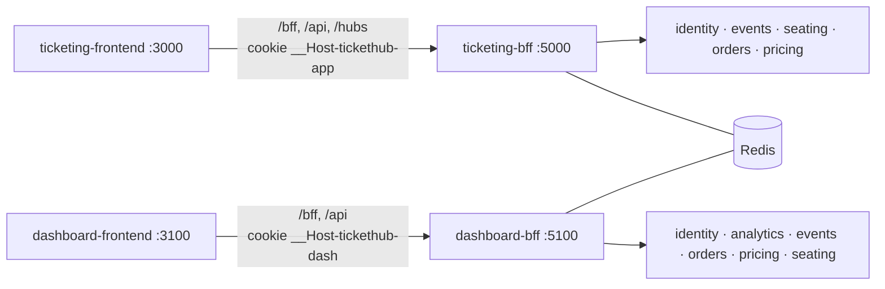

# Backends for Frontends

ticket-hub has two very different clients. The ticketing app is a transactional, bursty,
latency-sensitive UI with a live seat map. The dashboard is a read-heavy analytics UI that wants
chart-ready series and can tolerate a minute of staleness. Each gets its own BFF, deployed and scaled
on its own, and each frontend talks to nothing but its BFF on its own origin.



## Comparison

| | `ticketing-bff` | `dashboard-bff` |
|---|---|---|
| Users | Buyer, Organizer, Staff (Admin) | Owner, Organizer (own events only), Admin |
| Traffic | write-heavy, bursty, latency-sensitive | read-heavy, aggregated, cacheable |
| Live data | SignalR WebSocket proxy (`/hubs/seating`) | none; short cache TTLs instead |
| Caching | none (seat state must be fresh) | HybridCache, 30–120 s, keyed by endpoint + scope + filters |
| Security extras | antiforgery on writes, per-user rate limit on holds | role check at login, row-level scoping, export throttling |
| Response shape | page-shaped DTOs (`EventPage`, `CheckoutPage`, `MyTicketsPage`) | KPI cards, chart series, table rows |
| Proxying | YARP for most CRUD, the hub, and orders/tickets | YARP only for venue/category lookups |

## Session and token model

1. The SPA calls `GET /bff/user` on startup. The BFF answers with `isAuthenticated` and sets a
   readable `XSRF-TOKEN-APP` (or `-DASH`) cookie containing an antiforgery request token.
2. `POST /bff/login` (with `X-CSRF: 1` and `X-XSRF-TOKEN`) sends the credentials to identity. The
   access and refresh tokens are stored in Redis under `bff:{app}:session:{sid}` for seven days.
3. The browser gets a cookie authentication ticket (`HttpOnly`, `Secure`, `SameSite=Strict`, path `/`,
   `__Host-` prefix) holding the user's claims and the session id. Nothing in it is a usable token.
4. Each request: cookie middleware validates the ticket and checks the session still exists in Redis
   (logout anywhere kills it everywhere). `TokenAccessor` returns the access token, refreshing it
   silently when less than a minute is left. A per-session lock stops parallel requests from rotating
   the same refresh token twice.
5. Downstream calls get `Authorization: Bearer …` from `BffTokenHandler` (typed clients) or a YARP
   request transform. The session cookie is stripped from proxied requests.
6. `POST /bff/logout` revokes the refresh token at identity and deletes the Redis session.

Why the two apps can't share a session: different cookie names, and different data-protection
application names and key rings (`bff:app:dp-keys` vs `bff:dash:dp-keys`), so a ticketing cookie
can't even be decrypted by the dashboard BFF. Cookies ignore ports, which is also why the XSRF cookie
names differ per app.

CSRF: every state-changing `/bff` or `/api` call needs the custom `X-CSRF: 1` header (a cross-site
form can't send it without a CORS preflight, which only the app's own origin passes) and a valid
antiforgery token. CORS allows exactly one origin per BFF.

## Aggregation endpoints

### ticketing-bff

| Endpoint | Calls (in parallel) | Critical? |
|---|---|---|
| `GET /bff/events/{id}/page` | events detail + layout, seating `GetAvailability` (gRPC), pricing `/prices/{id}` | events yes; seating and pricing degrade to `partial` |
| `GET /bff/checkout/{holdId}` | seating `GetHold` (gRPC) first, then pricing locks, orders quote, events detail | hold yes (410 if gone or not yours) |
| `GET /bff/me/tickets` | orders `/tickets/mine`, then events summaries | orders yes |

### dashboard-bff

| Endpoint | Calls |
|---|---|
| `GET /bff/overview` | analytics KPIs + events stats |
| `GET /bff/sales/timeseries` | analytics |
| `GET /bff/breakdowns?by=…` | analytics + events summaries (for `by=event`) |
| `GET /bff/events/performance` | analytics + seating `GetSoldCounts` (live sold beats the read side's lag) |
| `GET /bff/events/{id}/insights` | analytics + pricing history + events |
| `GET /bff/forecast/revenue?horizon=` | analytics |
| `GET /bff/demand/heatmap`, `/demand/lead-time`, `/funnel`, `/pricing-impact`, `/alerts` | analytics |
| `GET /bff/cancellations` | orders |
| `GET /bff/export/{report}.csv` | analytics, streamed through CsvHelper |

Partial example:

```json
{
  "kpis": [ { "key": "grossRevenue", "value": 92933.5, "previous": 64610.0, "change": 0.4384 } ],
  "trend": { "dates": ["2025-06-02", "…"], "grossRevenue": [3120.0, "…"] },
  "events": null,
  "partial": true,
  "failures": ["events: HttpRequestException"]
}
```

## Row-level scoping

`ScopeResolver` turns the signed-in user into a scope:

- Owner/Admin: unrestricted (`eventIds` omitted unless they filter).
- Organizer: the union of their events according to analytics (historic) and events (including new
  drafts), cached for 60 s.

`DashboardQuery.ToQuery(scope)` builds every downstream query string and always injects
`eventIds`. If an organizer asks for someone else's event id, it's dropped (and an empty list means
"nothing", not "everything"). Insights for an out-of-scope event return 404. The cache key includes
the scope, so cached numbers can't leak between organizers.

## Tests that pin this down

[`tests/TicketHub.Bff.Tests`](../tests/TicketHub.Bff.Tests) covers: aggregation with stubbed
downstreams and the partial path; browser responses never containing tokens; cookie flags; CSRF;
a ticketing cookie being rejected by the dashboard; a Buyer getting 403; organizers only receiving
their own events; cache MISS→HIT and per-scope keys; CSV export and its throttle.
