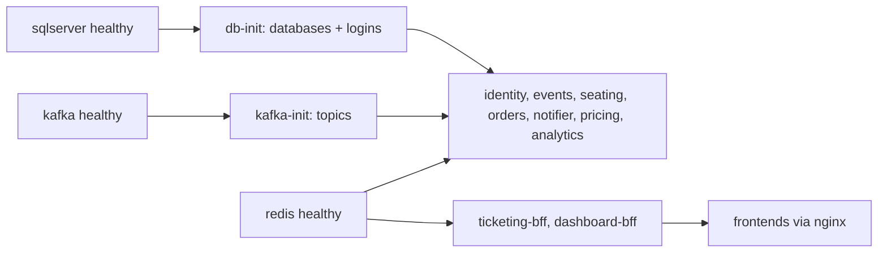
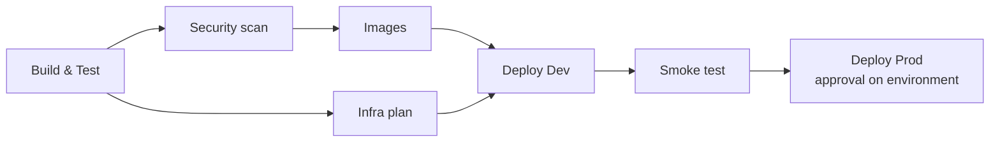

# Deployment

Three layers, each usable on its own: Docker Compose for a laptop, a Helm chart for Kubernetes, and
Terraform for the Azure resources the chart expects. Azure DevOps ties them together.

## Docker Compose

[`deploy/docker-compose.yml`](../deploy/docker-compose.yml) runs the whole platform;
[`deploy/docker-compose.override.yml`](../deploy/docker-compose.override.yml) publishes every service
port for debugging. The root [`compose.yaml`](../compose.yaml) includes both and reads `.env`, so from
the repository root:

```bash
cp .env.example .env
docker compose up --build
```

Start-up order is enforced with health checks:



| Container | Notes |
|---|---|
| `sqlserver` | SQL Server 2022 CU17 (amd64; runs under emulation on Apple silicon) |
| `db-init` | runs [`deploy/sql/init.sql`](../deploy/sql/init.sql) with `sqlcmd` variables from `.env` |
| `kafka`, `kafka-init` | KRaft single node; [`create-topics.sh`](../deploy/kafka/create-topics.sh) creates business, retry and DLQ topics |
| `kafka-ui` | http://localhost:8085 |
| `redis`, `mailhog`, `jaeger` | supporting infrastructure |
| .NET services | multi-stage images on `aspnet:9.0.2`, run as the non-root `$APP_UID`, health check on `/alive` |
| `pricing`, `analytics` | `python:3.13.3-slim-bookworm` + ODBC Driver 18, uid 10001, Alembic migrations on start |
| `ticketing-frontend`, `dashboard-frontend` | Angular production builds served by unprivileged nginx, proxying `/bff` (and `/hubs`) to their BFF |
| `seed-history` (profile `seed`) | one-shot: `docker compose run --rm seed-history` |
| `load-sim` (profile `loadsim`) | one-shot: `docker compose run --rm load-sim --buyers=200` |
| `stripe-cli` (profile `stripe`) | forwards test-mode webhooks to `orders:8080/webhooks/stripe` |

Validate without starting anything:

```bash
docker compose -f deploy/docker-compose.yml --env-file .env.example config -q
```

Check health once it's up:

```bash
for p in 5201 5202 5203 5204 5205 5000 5100; do curl -s localhost:$p/health; echo; done
curl -s localhost:8001/health; curl -s localhost:8002/health
```

## Kubernetes (Helm)

[`deploy/helm/ticket-hub`](../deploy/helm/ticket-hub) is an umbrella chart. All workloads are
described in `values.yaml` under `services:` and rendered by the library chart
[`charts/service-lib`](../deploy/helm/ticket-hub/charts/service-lib), so every service gets the same
shape:

- Deployment (non-root, no privilege escalation, rolling update with `maxUnavailable: 0`) with
  startup/liveness probes on `/alive` and readiness on `/health`
- Service (seating also exposes `grpc` on 8081 with `appProtocol: kubernetes.io/h2c`)
- ConfigMap from `global.env` + the service's `env` (values can reference the release name)
- `secretKeyRef`s into one Secret (`ticket-hub-secrets`), created from placeholders in dev and
  supplied by Key Vault in prod (`secrets.create: false`)
- PodDisruptionBudget where `pdb` is set
- HorizontalPodAutoscaler on **seating**, **orders** and **ticketing-bff**

Chart-level templates add:

- two NGINX Ingresses: `app.tickethub.local` (frontend + `/bff`, `/api`, `/hubs` to the ticketing BFF,
  with long read timeouts and cookie affinity for SignalR) and `dashboard.tickethub.local`
- a ServiceAccount annotated for **Azure workload identity** (`azure.workload.identity/client-id`),
  with pods labelled `azure.workload.identity/use: "true"`
- an optional **CronJob** that retrains forecasts (`python -m app.jobs all`), enabled in prod

Kafka isn't part of the chart; it's expected to run in-cluster (e.g. Strimzi, `ticket-hub-kafka-bootstrap.kafka:9092`).

Validate locally (no cluster needed):

```bash
helm dependency build deploy/helm/ticket-hub
helm lint deploy/helm/ticket-hub
helm template th deploy/helm/ticket-hub -f deploy/helm/ticket-hub/values-dev.yaml
helm template th deploy/helm/ticket-hub -f deploy/helm/ticket-hub/values-prod.yaml
```

`values-dev.yaml` runs single replicas with small HPAs and no TLS; `values-prod.yaml` raises replicas
and HPA limits, enables TLS via cert-manager, turns on the CronJob and expects secrets from Key Vault.

## Terraform (Azure)

```
infra/terraform/
├── modules/
│   ├── aks/                 AKS with OIDC issuer + workload identity, Azure RBAC, Cilium, autoscaling user pool, Key Vault CSI
│   ├── acr/                 registry + AcrPull for the kubelet identity
│   ├── mssql/               logical server (Entra ID admin only), one DB per service, larger analytics DB, firewall / private endpoint
│   ├── redis/               Azure Cache for Redis, TLS only, noeviction
│   ├── keyvault/            RBAC vault, placeholder secrets for Stripe test keys and signing keys
│   ├── log-analytics/       workspace for Container Insights
│   └── federated-identity/  user-assigned identity, federated credential for the chart's ServiceAccount, Key Vault Secrets User
└── envs/
    ├── dev/                 small SKUs, public endpoints with a placeholder firewall range
    └── prod/                Standard AKS tier, Premium ACR, private SQL endpoint, bigger analytics DB
```

Naming is `th-{env}-{location_short}-{resource}` and every resource is tagged with `project`,
`environment` and `managed_by`. The backend is a placeholder `azurerm` block; the pipeline passes the
real storage account. Copy `terraform.tfvars.example` to `terraform.tfvars` (git-ignored) to plan by hand.
All ids in the examples are `00000000-0000-0000-0000-000000000000`.

Validate locally without Azure credentials:

```bash
cd infra/terraform
terraform fmt -check -recursive
cd envs/dev && terraform init -backend=false && terraform validate
cd ../prod && terraform init -backend=false && terraform validate
```

Provider versions are locked in each env's `.terraform.lock.hcl` (hashes for Linux, macOS and Windows).

## Azure DevOps pipeline

[`azure-pipelines.yml`](../azure-pipelines.yml) with templates in
[`deploy/pipelines/templates`](../deploy/pipelines/templates):



| Stage | What happens |
|---|---|
| Build & Test | [`detect-changes.yml`](../deploy/pipelines/templates/detect-changes.yml) diffs the commit and sets a flag per component; only changed parts build. .NET (`--locked-mode` restore, tests with coverage, Testcontainers on the hosted agent's Docker), pytest per Python service, `ng build` + `ng test` per frontend. Test results and Cobertura coverage are published. |
| Security scan | `dotnet list package --vulnerable`, `npm audit`, `pip-audit`; reports are published as an artifact and never fail the build |
| Images | `Docker@2` build-and-push to ACR via the `acr-connection` service connection, tagged with build id and commit; main branch only |
| Infra plan | `TerraformTaskV4@4` init/validate/plan for dev and prod via `azure-arm-connection`; plans are published as artifacts. Nothing is applied by the pipeline. |
| Deploy Dev | `HelmDeploy@0` `upgrade --install --atomic` into the `ticket-hub` namespace, environment `ticket-hub-dev` |
| Smoke test | runs a curl pod in the cluster and checks `/health` on every service and both BFFs |
| Deploy Prod | same as dev with `values-prod.yaml`, environment `ticket-hub-prod`, which carries the manual approval check |

Variables come from the `ticket-hub-common` variable group:

| Variable | Example (placeholder) |
|---|---|
| `acrLoginServer` | `thprodacr.azurecr.io` |
| `aksResourceGroupDev` / `aksClusterDev` | `th-dev-uks-rg` / `th-dev-uks-aks` |
| `aksResourceGroupProd` / `aksClusterProd` | `th-prod-uks-rg` / `th-prod-uks-aks` |
| `tfStateResourceGroup` / `tfStateStorageAccount` | `th-tfstate-rg` / `thtfstate` |
| `subscriptionId`, `tenantId`, `deployerObjectId` | `00000000-0000-0000-0000-000000000000` |
| `sqlAdminGroupName`, `sqlAdminGroupObjectId` | Entra group for SQL admins |
| `workloadClientIddev`, `workloadClientIdprod` | output `workload_identity_client_id` from Terraform |

Locally you can sanity-check the YAML with any YAML parser; every template path referenced from the
pipeline exists under `deploy/pipelines/templates`.
