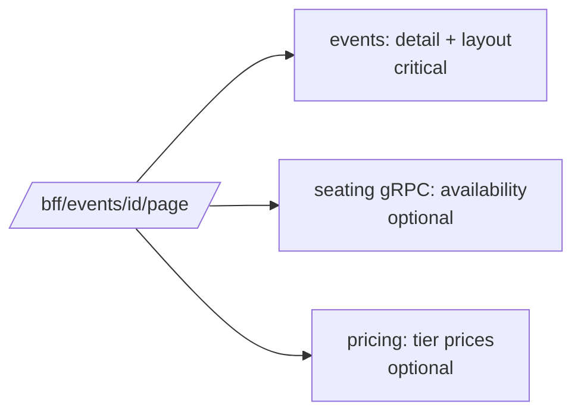

# Design patterns

Each section covers the problem the pattern solves here, how it's implemented, where to find it,
and what it costs. Links point at the files that actually do the work.

## Backends for Frontends (BFF)

**Problem.** The ticketing app needs low-latency writes, seat locking and a live WebSocket; the
dashboard needs aggregated, cacheable, scoped read models. One API gateway serving both would either
be too generic for each or full of client-specific branches. Neither app should ever hold a JWT.

**Implementation.** Two ASP.NET Core apps, each owning a cookie session for exactly one frontend.
Shared plumbing (cookie options, Redis token store, silent refresh, CSRF) is in a small library; the
endpoints and policies are per BFF.

- [`shared/TicketHub.BffKit/BffSession.cs`](../shared/TicketHub.BffKit/BffSession.cs) – cookie auth, login/logout/user, CSRF middleware
- [`shared/TicketHub.BffKit/TokenAccessor.cs`](../shared/TicketHub.BffKit/TokenAccessor.cs) – server-side tokens, refresh, `BffTokenHandler`
- [`src/bff/TicketHub.TicketingBff/Program.cs`](../src/bff/TicketHub.TicketingBff/Program.cs) – YARP routes, hold rate limiting, WebSocket proxy
- [`src/bff/TicketHub.DashboardBff/Program.cs`](../src/bff/TicketHub.DashboardBff/Program.cs) – HybridCache, export throttling, role-restricted session

**Trade-offs.** Two deployables instead of one, and some duplicated proxy configuration. In return
each BFF's API is shaped like its screens, and security rules (who may log in, what gets cached,
what's rate limited) are obvious from one file. See [bff.md](bff.md).

## API Composition

**Problem.** A seat-map page needs data from three services; a dashboard drill-down needs four.
Making the browser do that fan-out means more round trips and leaking internal service boundaries.

**Implementation.** BFF endpoints call downstream services in parallel and merge the result. Calls
that aren't essential go through `Fanout.Optional`, which records the failure and lets the response
go out with `partial: true` instead of failing.

- [`shared/TicketHub.BffKit/Aggregation.cs`](../shared/TicketHub.BffKit/Aggregation.cs) – `Fanout`
- [`src/bff/TicketHub.TicketingBff/Endpoints/AggregationEndpoints.cs`](../src/bff/TicketHub.TicketingBff/Endpoints/AggregationEndpoints.cs) – `/bff/events/{id}/page`, `/bff/checkout/{holdId}`, `/bff/me/tickets`
- [`src/bff/TicketHub.DashboardBff/Endpoints/DashboardEndpoints.cs`](../src/bff/TicketHub.DashboardBff/Endpoints/DashboardEndpoints.cs) – `/bff/overview`, `/bff/events/performance`, `/bff/events/{id}/insights`

**Trade-offs.** The BFF's latency is the slowest required call; timeouts from the resilience handler
keep that bounded. Partial responses push a little complexity into the UI (a banner, `unknown` seats).

## Database per Service

**Problem.** Shared tables make every schema change a cross-team negotiation and let services couple
through the database instead of through contracts.

**Implementation.** Each service has its own database and login (`TicketHub_Identity`, …,
`TicketHub_Analytics`) and runs its own migrations. Seating keeps hot state in Redis and only sold
seats in SQL. Analytics has its own database with columnstore fact tables.

- [`deploy/helm/ticket-hub/files/init.sql`](../deploy/helm/ticket-hub/files/init.sql) – one database and one `db_owner`-on-its-own-DB login per service
- EF Core contexts, e.g. [`src/services/orders/TicketHub.Orders/Data/OrdersDbContext.cs`](../src/services/orders/TicketHub.Orders/Data/OrdersDbContext.cs)
- Alembic migrations, e.g. [`src/services/analytics/alembic/versions/0001_initial.py`](../src/services/analytics/alembic/versions/0001_initial.py)
- [`infra/terraform/modules/mssql/main.tf`](../infra/terraform/modules/mssql/main.tf) – one Azure SQL database per service

**Trade-offs.** No joins across services: anything that needs another service's data either calls it
or keeps its own copy from events (notifier keeps event titles, seating keeps event dates). Reporting
across everything only exists in analytics.

## Choreography-based Saga (with compensating transactions)

**Problem.** Buying seats spans seating, pricing, orders and notifier. A distributed transaction
isn't an option, but seats must never be sold twice and money must never be kept for seats a buyer
didn't get.

**Implementation.** Each service reacts to the previous step's event:
`seat-held → order created → payment → order-paid → seats-sold → tickets-issued`. Compensations:

- hold expires → `hold-expired` → pending order becomes `Expired`
- payment fails → orders releases the hold over gRPC → `seat-released`, order `Failed`
- payment succeeds after the hold expired → `ConfirmHold` fails → automatic full refund → `order-refunded`

Files:
- [`src/services/seating/TicketHub.Seating/Holds/HoldService.cs`](../src/services/seating/TicketHub.Seating/Holds/HoldService.cs) and [`Holds/HoldExpiryWorker.cs`](../src/services/seating/TicketHub.Seating/Holds/HoldExpiryWorker.cs)
- [`src/services/orders/TicketHub.Orders/Ordering/OrderService.cs`](../src/services/orders/TicketHub.Orders/Ordering/OrderService.cs) – `OnPaymentSucceededAsync`, `OnPaymentFailedAsync`
- [`src/services/seating/TicketHub.Seating/Messaging/SeatingHandlers.cs`](../src/services/seating/TicketHub.Seating/Messaging/SeatingHandlers.cs) – `OrderPaidHandler`
- [`src/services/orders/TicketHub.Orders/Messaging/OrderHandlers.cs`](../src/services/orders/TicketHub.Orders/Messaging/OrderHandlers.cs) – `SeatsSoldHandler`, `HoldExpiredHandler`

**Trade-offs.** No single place shows the whole flow, which is why [how-it-works.md](how-it-works.md)
exists. Tickets appear a moment after payment rather than instantly; the UI polls briefly.

## Orchestration-based Saga

**Problem.** Cancelling an event means refunding every paid order, voiding every ticket and telling
every buyer. Hundreds of orders, an external payment provider that can fail, and a process that must
survive restarts. Choreography would scatter that logic and make "how far did we get?" unanswerable.

**Implementation.** Orders owns an explicit orchestrator. `events.event-cancelled` creates a
`CancellationSaga` row with one `CancellationSagaStep` per paid order. A background worker advances
each step `Pending → Refunded → TicketsVoided → Completed`, saving after every stage. Refunds use the
idempotency key `cancel-{orderId}`, so a resumed step can't refund twice. Progress is exposed at
`GET /cancellations` and shown on the dashboard.

- [`src/services/orders/TicketHub.Orders/Sagas/CancellationSagaOrchestrator.cs`](../src/services/orders/TicketHub.Orders/Sagas/CancellationSagaOrchestrator.cs)
- [`tests/TicketHub.Orders.Tests/OrderFlowTests.cs`](../tests/TicketHub.Orders.Tests/OrderFlowTests.cs) – resumes after a failure without double refunds

**Trade-offs.** More state to store, and the orchestrator is a single point of logic. That's the
point here: support staff can see exactly which refunds are outstanding.

## Transactional Outbox + Idempotent Consumer

**Problem.** "Save the order and publish `order-paid`" must be atomic: if the database commit
succeeds and Kafka is briefly down, the event can't be lost; if Kafka redelivers, it can't be applied twice.

**Implementation.** `db.Enqueue(topic, key, payload)` adds an `outbox_messages` row in the same
`SaveChanges` as the business change, along with the current `traceparent`. `OutboxDispatcher`
claims rows with a short lease and publishes them. Consumers record `(event id, consumer)` in
`processed_events` in the same transaction as their own changes; a duplicate key means another
replica already handled it. Analytics does the same in Python.

- [`shared/TicketHub.BuildingBlocks/Persistence/MessagingModel.cs`](../shared/TicketHub.BuildingBlocks/Persistence/MessagingModel.cs) – `Enqueue`, `AlreadyProcessedAsync`, `MarkProcessed`
- [`shared/TicketHub.BuildingBlocks/Persistence/OutboxDispatcher.cs`](../shared/TicketHub.BuildingBlocks/Persistence/OutboxDispatcher.cs)
- [`src/services/analytics/app/ingest.py`](../src/services/analytics/app/ingest.py) – `Ingestor.handle`
- [`src/services/pricing/app/handlers.py`](../src/services/pricing/app/handlers.py) – `PricingHandlers._once`

**Trade-offs.** At-least-once delivery with a small delay (the dispatcher polls every 500 ms when idle).
The outbox table needs periodic cleanup of processed rows in a long-running system.

## Idempotency Key

**Problem.** Double-clicks, retries after a timeout and Stripe's own webhook retries must not create
two orders, two PaymentIntents or two state transitions.

**Implementation.** `POST /orders` requires an `Idempotency-Key` header; `(BuyerId, IdempotencyKey)`
is unique, and a duplicate returns the original order. The same key (prefixed) goes to Stripe as its
`IdempotencyKey`, so even a retried call returns the same PaymentIntent. Webhooks are deduplicated by
provider event id in `payment_webhook_events`. The frontend keeps one key per hold in `sessionStorage`
so a reload mid-checkout reuses it.

- [`src/services/orders/TicketHub.Orders/Ordering/OrderService.cs`](../src/services/orders/TicketHub.Orders/Ordering/OrderService.cs) – `CreateAsync`, `HandlePaymentAsync`
- [`ticketing-frontend/src/app/core/idempotency.ts`](../ticketing-frontend/src/app/core/idempotency.ts)
- [`tests/TicketHub.Orders.Tests/OrdersSqlServerTests.cs`](../tests/TicketHub.Orders.Tests/OrdersSqlServerTests.cs) – eight concurrent creates, one order

## Distributed Lock

**Problem.** Thousands of buyers click the same front-row seats in the same second. Checking and then
setting would let two of them in.

**Implementation.** Each seat is a Redis key `seating:seat:{event}:{seat}` whose value is the owning
hold id and whose TTL is the hold length. A Lua script checks every requested seat (and the sold set)
and only then sets them all, so a multi-seat hold is all-or-nothing. Releasing and confirming are Lua
scripts that only touch keys still owned by that hold, so a stale release can't free someone else's seat.

- [`src/services/seating/TicketHub.Seating/Holds/HoldStore.cs`](../src/services/seating/TicketHub.Seating/Holds/HoldStore.cs)
- [`tests/TicketHub.Seating.Tests/HoldTests.cs`](../tests/TicketHub.Seating.Tests/HoldTests.cs) – 60 parallel buyers, no seat held twice

**Trade-offs.** Redis is now on the critical path for holds; Redis is configured with `noeviction` so
a memory squeeze can't silently drop locks. The sold-seats primary key in SQL is the backstop.

## Circuit Breaker + Retry + Timeout + Bulkhead

**Problem.** A slow pricing service shouldn't take checkout down with it, and a struggling service
shouldn't be hammered with retries.

**Implementation.** Every outbound client uses `AddStandardResilienceHandler()` from
`Microsoft.Extensions.Http.Resilience`: a concurrency limiter (bulkhead), a total timeout, retries with
jittered backoff (disabled for unsafe methods on the identity client), a circuit breaker and a
per-attempt timeout. gRPC clients get the same pipeline.

- [`src/services/orders/TicketHub.Orders/Program.cs`](../src/services/orders/TicketHub.Orders/Program.cs) – seating gRPC and pricing REST
- [`src/bff/TicketHub.TicketingBff/Program.cs`](../src/bff/TicketHub.TicketingBff/Program.cs), [`src/bff/TicketHub.DashboardBff/Program.cs`](../src/bff/TicketHub.DashboardBff/Program.cs)
- [`shared/TicketHub.BffKit/BffSession.cs`](../shared/TicketHub.BffKit/BffSession.cs) – identity client without retries on POST

**Trade-offs.** Defaults are tuned for "typical web API"; heavy analytics queries could hit the
attempt timeout, which is why dashboard responses are cached.

## Anti-Corruption Layer

**Problem.** Stripe's model (PaymentIntents, events, signatures, minor units) shouldn't leak into
order logic, and local development shouldn't need a Stripe account.

**Implementation.** `IPaymentProvider` speaks the domain's language: create a payment, refund, parse
a webhook into a `PaymentNotification`. `StripePaymentProvider` translates to and from Stripe.net;
`MockPaymentProvider` signs its own webhooks the same way so the verification path is exercised.
The provider is picked at startup: a `sk_test_` key selects Stripe, anything else the mock.

- [`src/services/orders/TicketHub.Orders/Payments/IPaymentProvider.cs`](../src/services/orders/TicketHub.Orders/Payments/IPaymentProvider.cs)
- [`src/services/orders/TicketHub.Orders/Payments/StripePaymentProvider.cs`](../src/services/orders/TicketHub.Orders/Payments/StripePaymentProvider.cs)
- [`src/services/orders/TicketHub.Orders/Payments/MockPaymentProvider.cs`](../src/services/orders/TicketHub.Orders/Payments/MockPaymentProvider.cs)

## CQRS + Materialized View

**Problem.** Dashboard queries (twelve months of sales, by weekday and hour, against forecasts)
would be expensive and dangerous against the transactional databases.

**Implementation.** Analytics is a separate read side built only from Kafka events: dimensions
(`dim_event`, `dim_date`, `dim_venue_section`), facts (`fact_ticket_sale`, `fact_hold`, …), rollups
(`daily_event_sales`, `daily_platform_sales`) and precomputed forecasts. Rollups rebuild every five
minutes and forecasts every hour, so dashboard reads are simple selects.

- [`src/services/analytics/app/ingest.py`](../src/services/analytics/app/ingest.py), [`rollups.py`](../src/services/analytics/app/rollups.py), [`jobs.py`](../src/services/analytics/app/jobs.py)
- [`src/services/analytics/app/models.py`](../src/services/analytics/app/models.py)

**Trade-offs.** Eventual consistency: a sale shows up in analytics a few seconds later and in the
rollups within five minutes. The performance table patches live sold counts from seating to hide that lag.

## Cache-Aside

**Problem.** Seating needs the seat-map layout on every hold and availability call, and the dashboard
hits the same aggregates over and over.

**Implementation.**
- Seating reads layouts through `LayoutCache`: Redis first, otherwise the events service, then store for ten minutes; invalidated when an event is published.
  [`src/services/seating/TicketHub.Seating/Layout/LayoutCache.cs`](../src/services/seating/TicketHub.Seating/Layout/LayoutCache.cs)
- Dashboard responses go through `ResponseCache` (HybridCache: in-process L1 + Redis L2), keyed by endpoint, user scope and normalised filters, with 30–120 s TTLs. Partial responses aren't cached.
  [`src/bff/TicketHub.DashboardBff/Endpoints/ResponseCache.cs`](../src/bff/TicketHub.DashboardBff/Endpoints/ResponseCache.cs)

**Trade-offs.** Numbers can be up to two minutes old on the dashboard; the `X-Cache` header makes it visible.

## Rate Limiting

**Problem.** Spamming hold requests is the cheapest way to lock everyone else out of an on-sale, and
CSV exports touch every fact table.

**Implementation.** ASP.NET Core rate limiting: a fixed window per user on `POST /api/seating/holds`
in the ticketing BFF (YARP route policy `holds`), and a per-user fixed window on `/bff/export/*` in
the dashboard BFF (`exports`).

- [`src/bff/TicketHub.TicketingBff/Program.cs`](../src/bff/TicketHub.TicketingBff/Program.cs) and its `appsettings.json` route `holds-create`
- [`src/bff/TicketHub.DashboardBff/Program.cs`](../src/bff/TicketHub.DashboardBff/Program.cs), [`Endpoints/ExportEndpoints.cs`](../src/bff/TicketHub.DashboardBff/Endpoints/ExportEndpoints.cs)

**Trade-offs.** Limits are per BFF instance; with many replicas the effective limit is multiplied.
A Redis-backed limiter would fix that if it ever matters.

## Competing Consumers

**Problem.** One consumer can't keep up with an on-sale burst, and one replica going down shouldn't stop processing.

**Implementation.** Every service consumes with a Kafka consumer group; topics have six partitions
keyed by event id, so several replicas of seating, analytics or orders share the load while ordering
per event is kept. Replicas also compete for outbox rows (leases) and expiring holds (`ZREM` claim).

- [`shared/TicketHub.BuildingBlocks/Messaging/KafkaConsumerService.cs`](../shared/TicketHub.BuildingBlocks/Messaging/KafkaConsumerService.cs)
- [`src/services/analytics/app/messaging.py`](../src/services/analytics/app/messaging.py)
- [`deploy/helm/ticket-hub/values.yaml`](../deploy/helm/ticket-hub/values.yaml) – multiple replicas and HPAs

## Retry Topic + Dead Letter Topic, Distributed Tracing, Health Check API, Externalized Configuration

- **Retry and DLQ.** A handler failure republishes the message to `{group}.retry` with an attempt
  header; after three attempts it goes to `{group}.dlq` with the error. Partitions never block on a
  poison message. [`KafkaConsumerService.cs`](../shared/TicketHub.BuildingBlocks/Messaging/KafkaConsumerService.cs), [`messaging.py`](../src/services/pricing/app/messaging.py)
- **Distributed tracing.** OpenTelemetry in every service; trace context goes through HTTP, gRPC and
  Kafka headers, and is stored in the outbox. [`KafkaTracing.cs`](../shared/TicketHub.BuildingBlocks/Messaging/KafkaTracing.cs), [`ServiceDefaults.cs`](../shared/TicketHub.BuildingBlocks/Hosting/ServiceDefaults.cs), [`telemetry.py`](../src/services/analytics/app/telemetry.py)
- **Health check API.** `/alive` and `/health` everywhere, used by compose healthchecks, Kubernetes probes and the pipeline smoke test. [`ServiceDefaults.cs`](../shared/TicketHub.BuildingBlocks/Hosting/ServiceDefaults.cs), [`smoke-test.yml`](../deploy/pipelines/templates/smoke-test.yml)
- **Externalized configuration.** All settings come from environment variables: `.env` locally,
  ConfigMaps/Secrets in Helm, Key Vault (CSI-mounted files) in Azure. Provider switches pick the
  Azure-only integrations without code changes: `MESSAGING__PROVIDER` ([`KafkaOptions.cs`](../shared/TicketHub.BuildingBlocks/Messaging/KafkaOptions.cs)),
  `SECRETS__PROVIDER` ([`ServiceDefaults.cs`](../shared/TicketHub.BuildingBlocks/Hosting/ServiceDefaults.cs), [`config.py`](../src/services/analytics/app/config.py)). [`deploy/docker-compose.yml`](../deploy/docker-compose.yml), [`deploy/helm/ticket-hub/values.yaml`](../deploy/helm/ticket-hub/values.yaml)
