# How it works

This walks through the main journeys end to end. Each has a sequence diagram of the happy path and
at least one failure or compensation path. State diagrams for the main entities are at the end.

## 1. Signing in (both apps)

The browser never holds a JWT. It talks to its own BFF, which logs in against identity, keeps the
tokens in Redis and gives the browser an opaque, `HttpOnly` session cookie.

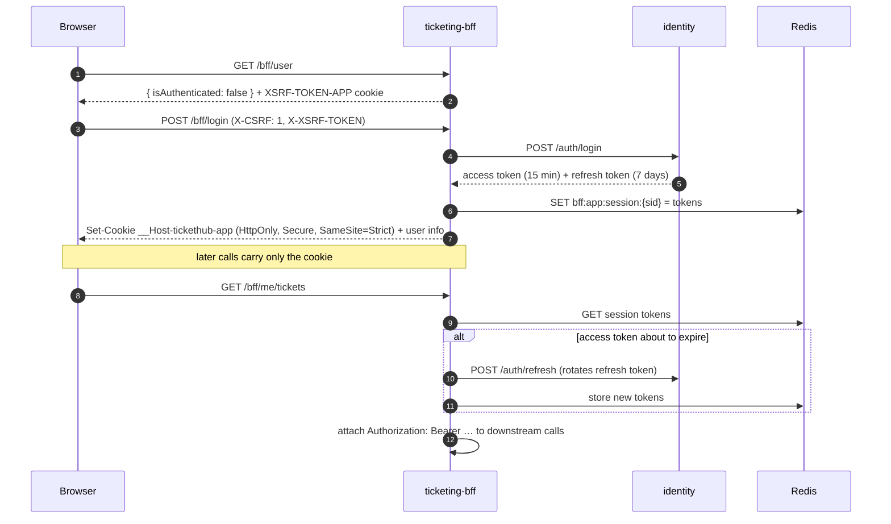

**Failure path:** if the refresh token was already rotated (someone replayed an old one), identity
revokes the whole token family and returns 401; the BFF drops the session and the next request gets 401.
A `Buyer` who logs in to the dashboard BFF gets 403 at login and no cookie is set.

## 2. Browsing and the live seat map

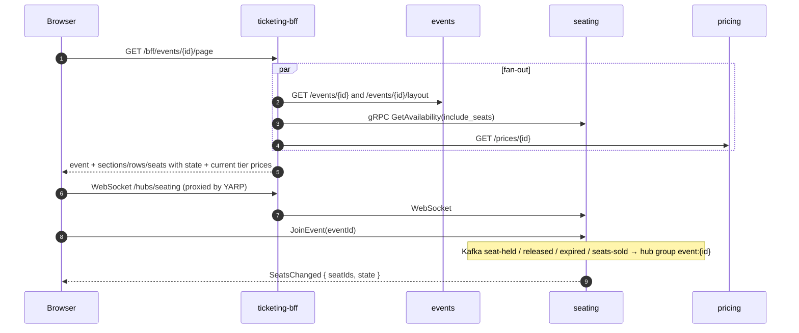

**Failure path:** if seating doesn't answer, the page still renders with `partial: true`; seat states
show as `unknown` and a banner warns that availability may be stale. If events is down the page fails
with 502, since there is nothing useful to show without the seat map.

## 3. Hold → pay → tickets (choreographed saga)

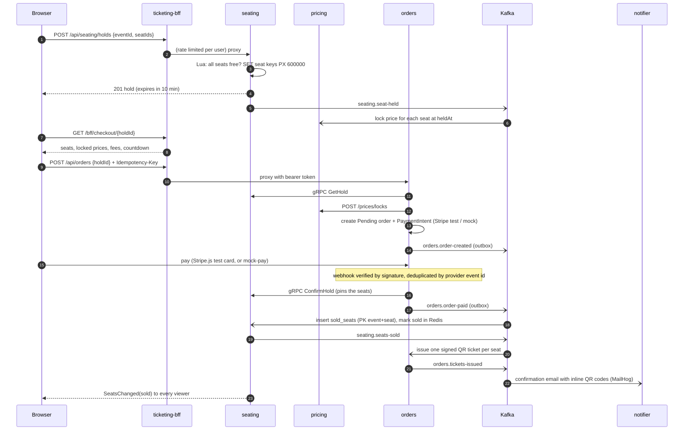

### Compensations

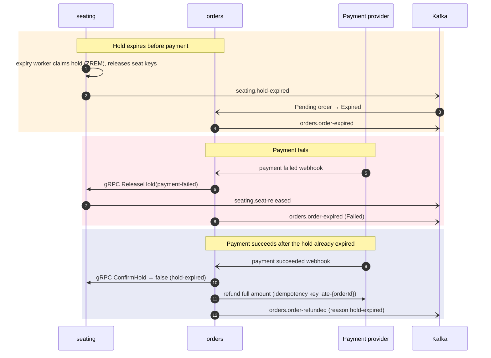

## 4. Door check-in

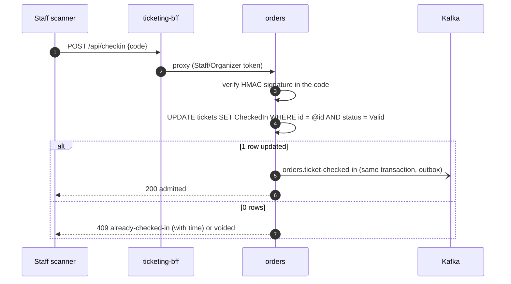

Forged or mistyped codes fail signature verification and never touch the database.

## 5. Event cancellation (orchestrated saga)

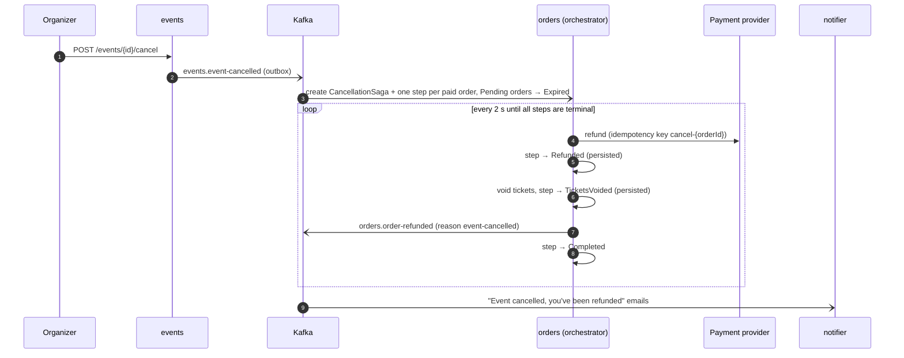

**Failure path:** if the provider refuses a refund, the step records the error and stays at
`Pending`; the next sweep retries it. After five attempts the step is `Failed` and the saga ends as
`CompletedWithErrors`, visible on the dashboard's alerts page. Because every stage is written before
the next starts, a crash mid-saga resumes where it left off, and the provider-side idempotency key
means a retried refund can't pay out twice.

## 6. Dashboard request

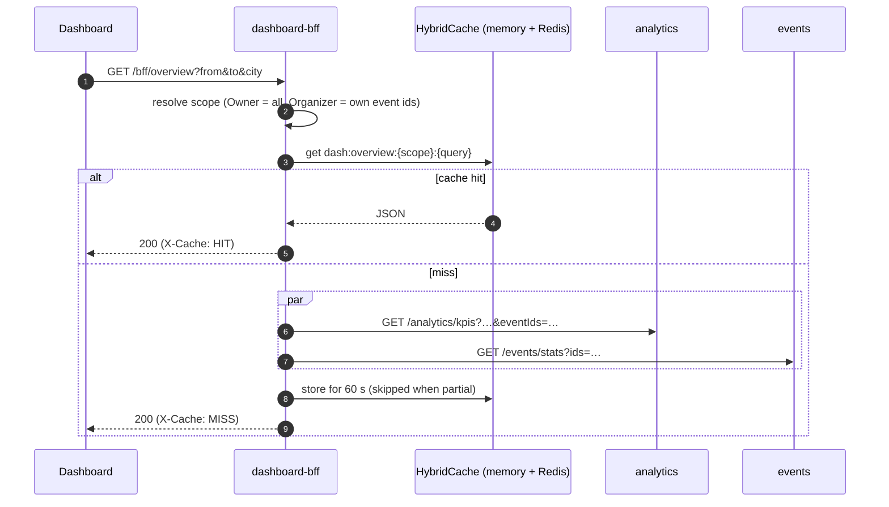

## State diagrams

### Order

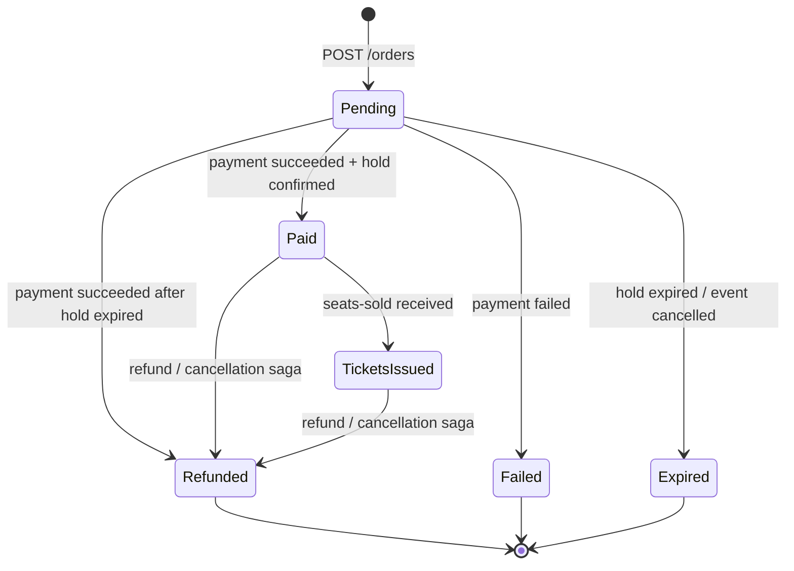

### Seat (as seen by seating)

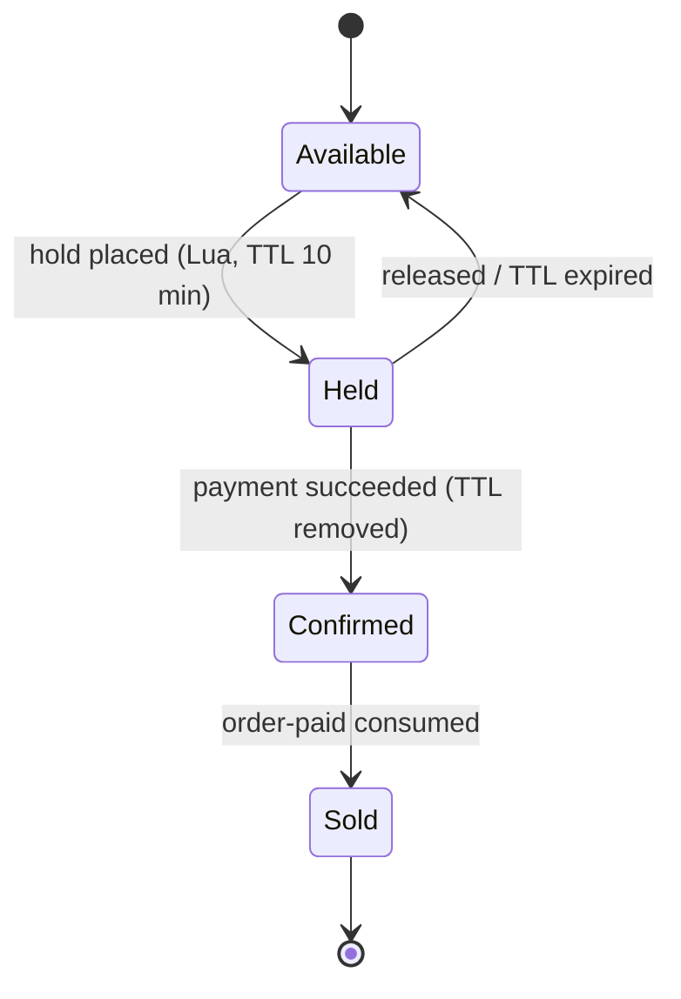

### Event

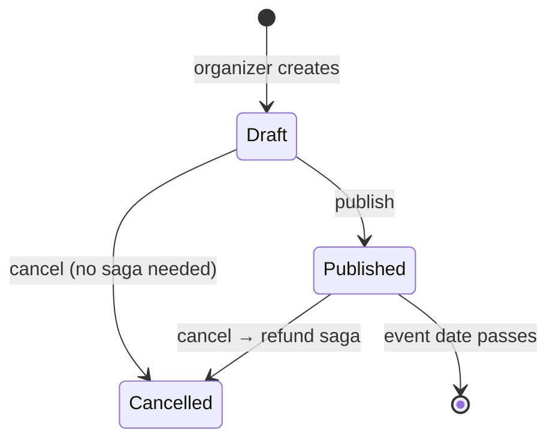

### Ticket

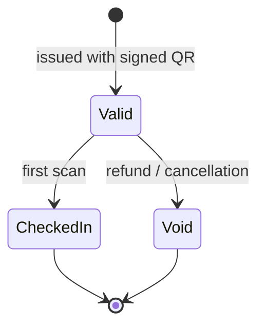

### Cancellation saga step

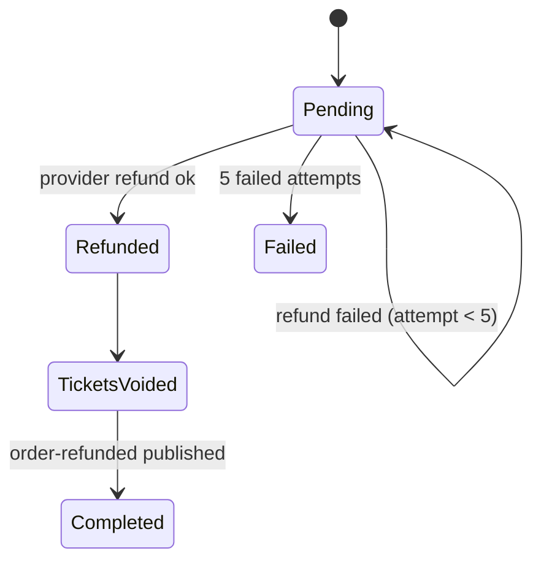
